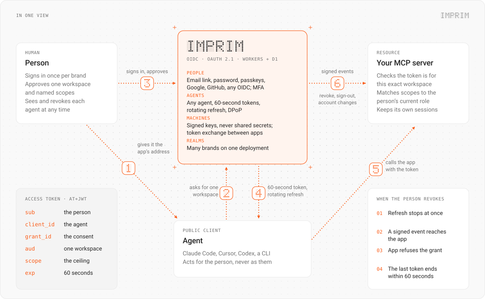
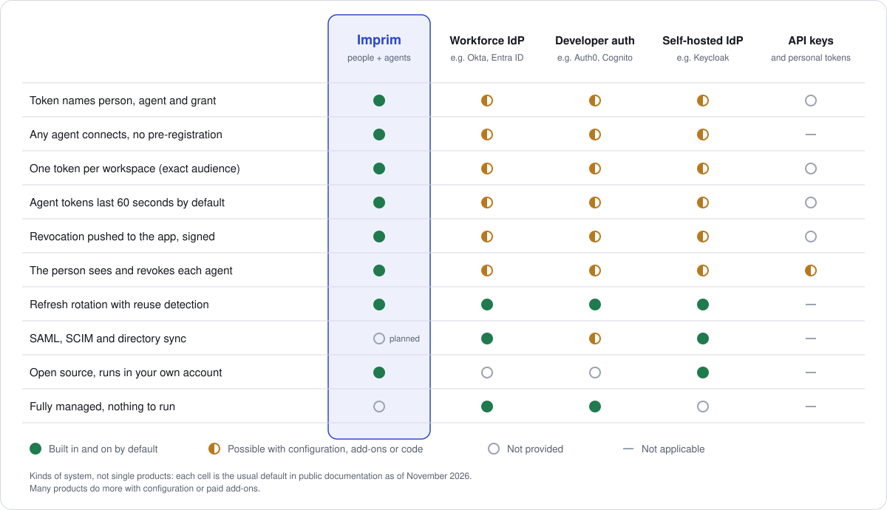

# Imprim

**Identity for people and the agents that act for them.** Imprim is an open-source OpenID Connect provider and
OAuth 2.1 authorization server that runs on Cloudflare Workers with D1. The Worker has no runtime dependencies; the account and admin app needs a build.

- **People sign in once** per brand, with an email link, a password (breach-checked), a passkey, GitHub, Google,
  Microsoft, Apple or any OpenID Connect provider, chosen per app. SSO across that brand's apps.
- **Two-factor where it matters:** authenticator apps, passkeys and recovery codes; per-app MFA policy, step-up
  (`acr_values`, `max_age`) and MFA for admins and for approving agents. An account page covers sessions, apps,
  agents, email change and deletion.
- **Agents connect for a person, never as one.** A person gives their agent (Claude Code, Cursor, Codex, a CLI) an
  app's MCP address. The agent discovers Imprim, the person approves one workspace and named scopes, and the agent
  gets 60-second, audience-bound tokens that the person can revoke at any time.
- **Apps keep authorisation.** Imprim proves who someone is and what they consented to. Your app owns its sessions
  and checks permissions on every request.
- **Shared and personal workspaces.** Products can opt in to share team memberships, base roles and invitations
  through Imprim, give each person a workspace of their own, and offer optional self-serve sign-up for team workspaces.
  [Shared workspaces](docs/WORKSPACES.md) · [Self-serve sign-up](docs/SIGNUP.md)
- **Many brands, one deployment.** Each realm has its own issuer host, signing keys, users, provider credentials,
  email sender, admins and branding. Branding is a look (palette, tone, type set and other tweaks) plus a name,
  copy, links and logos, and each app can override it.
- **Machines too.** Service clients (`client_credentials` with `private_key_jwt`), introspection, revocation,
  DPoP-bound tokens, token exchange between apps, and signed user lifecycle events.
- **Your people's language.** Pages and emails in English, Spanish, French, German and Portuguese (Brazil), chosen
  by the app's `ui_locales`, the person's choice or the browser. Every email has a branded HTML part, light and dark,
  beside its plain text.
- **Account and admin in one app.** Each person manages their profile, security, sessions and agents; admins manage
  apps, users, service clients, workspaces, branding, audit, keys and realms. One Lit app over JSON APIs.

Docs: **https://vibernt.github.io/imprim/**. Start with [Getting started](docs/GETTING_STARTED.md).

## Why Imprim exists

### [Read: Agents act for people. Identity should say so.](https://www.linkedin.com/pulse/agents-act-people-identity-should-say-so-vidhatanand-v--rmqic/)

How agents get into software today, where identity providers fall short for them, and the approach Imprim takes.

## OpenID conformance

Imprim passes the OpenID Foundation's [conformance suite](https://www.certification.openid.net/), the tests the
Foundation uses for certification, with **no failures** in all four OpenID provider profiles it implements:

| Profile | Tests | Result |
|---|---|---|
| Basic OP | 35 | 22 passed, 4 for review (screenshots), 4 warnings, 5 skipped (features Imprim does not offer) |
| Config OP | 1 | Passed |
| RP-Initiated Logout OP | 11 | 3 passed, 8 for review (screenshots) |
| Back-Channel Logout OP | 2 | Passed |

Run on 2026-11-17 against a staging deployment of the release now in production. How to run it,
what each warning and skip means, and what the suite found are in [OpenID certification](docs/CERTIFICATION.md).
The suite itself is run by hand. Imprim's own tests of the behaviour it checks,
[`tests/oidc-certification.test.mjs`](tests/oidc-certification.test.mjs) and [`tests/rs256.test.mjs`](tests/rs256.test.mjs),
run in [CI](.github/workflows/ci.yml) on every push to `main` and every pull request, on Node 22 and 24.

## In one view

<picture>
  <source media="(prefers-color-scheme: dark)" srcset="docs/assets/diagrams/overview-dark.svg">
  
</picture>

## How it compares

Most identity systems can be made to do much of this with enough configuration. The difference is what they are
built for. Imprim's defaults are set for agents acting for people: the token keeps the person, the agent and the
grant apart, it is valid for one workspace for 60 seconds, and revocation reaches the app. It does not yet offer the
enterprise directory features that workforce identity providers have.

<picture>
  <source media="(prefers-color-scheme: dark)" srcset="docs/assets/diagrams/comparison-dark.svg">
  
</picture>

## How it fits together

```text
Person ── browser ───────────┐                         ┌── D1: realms, users, clients, sessions, grants, keys, audit
Agent ─── code / device ─────┼──> Imprim (Worker) ─────┼── Queue: logout, revocation and user events
App ───── OIDC / OAuth ──────┤        │                ├── Email: sign-in links and security notices
Service ── private_key_jwt ──┘        │                ├── GitHub, Google, Microsoft, Apple, OIDC, Turnstile
                                      │                └── Static assets: the Fire design system
App MCP server <── signed access tokens ── verified with imprim-client, intersected with the person's role
```

Standards: OIDC Core with PKCE S256 and `iss` in responses (RFC 9207); OAuth 2.0 Authorization Server Metadata
(RFC 8414); Protected Resource Metadata (RFC 9728); Resource Indicators (RFC 8707); Client ID Metadata Documents and
Dynamic Client Registration (RFC 7591); Device Authorization (RFC 8628); `private_key_jwt` (RFC 7523); Back-Channel
Logout; Security Event Tokens (RFC 8417); Token Introspection (RFC 7662) and Revocation (RFC 7009); Token Exchange
(RFC 8693); DPoP (RFC 9449); WebAuthn Level 2 passkeys; TOTP (RFC 6238).

## Get started

| I want to | Read | Or tell my coding agent |
|---|---|---|
| Run Imprim | [Deploying](docs/DEPLOY.md) | *"Deploy Imprim to my Cloudflare account as staging, following docs/DEPLOY.md. Show me every command and SQL file first and ask me for each secret."* |
| Add sign-in to my app | [Integrating](docs/INTEGRATE.md) | *"Add sign-in with Imprim (issuer https://id.example.com, client my-app) to this app using imprim-client. Keep our sessions and roles, key users on (iss, sub), and add negative tests."* |
| Let agents use my app | [Integrating §4](docs/INTEGRATE.md#4-accept-agents-on-your-mcp-server) | *"Protect our MCP endpoint with Imprim: serve resource metadata, return the challenge, verify each token's exact audience, and check the person's role on every call."* |
| Connect my agent | Nothing to set up | *"Connect to the MCP server at https://app.example.com/w/team-one/mcp."* |

The full prompts are in [Getting started](docs/GETTING_STARTED.md).

Run the checks locally (Node 22.13 or later):

```bash
npm ci
```

```bash
npm run test:quiet
```

```bash
npm run check
```

## Repository

| Path | Contents |
|---|---|
| `apps/server/src/` | The Worker: routes, sign-in, OIDC, agents, realms, admin console, pages, languages (`i18n/`), email, maintenance |
| `apps/server/public/` | Static assets: generated Fire assets (`fire/`), the built app (`ui/`) and `_headers` |
| `apps/web/` | The Lit account and admin app |
| `apps/server/migrations/` | D1 schema, `0001` to `0026` |
| `packages/imprim-client/` | Zero-dependency client for apps and MCP servers |
| `examples/mcp-probe/` | A complete MCP server that accepts agents through Imprim, and a scripted agent that tests it |
| `scripts/` | Offline SQL generators for realms, clients and user imports; checks (including translations); email preview; client build |
| `tests/` | `node:test` suites on a real SQLite harness, including negative tests at every trust boundary |
| `docs/` | Guides, protocol, security and operations ([index](docs/README.md)) |
| `docs/fire/` | Fire's guide, writing rules and class vocabulary, and how Imprim uses Fire |

## Built with

Every page uses the [Fire v0.9.1 design system](docs/fire/README.md) (MIT), from its pinned package, with
Lit for the account and admin app, fonts under the SIL Open Font License and [Lucide](https://lucide.dev) icons (ISC).

## Status

Imprim runs in production for Vibernt's apps and passes the OpenID conformance suite (above). In live use, Claude
Code connects to an app's MCP server with a person's approval, refreshes its 60-second token, and a revocation from the
account page reaches the app within seconds. What each release changed is in the [Changelog](CHANGELOG.md); what has
not yet been verified live is in [Security](docs/SECURITY.md#not-yet-verified-live); what comes next is in the
[Roadmap](docs/ROADMAP.md).

## Contributing

Contributions are welcome. Open an issue to agree the design, then send a pull request with tests: negative tests
at every trust boundary, plus `npm run test:quiet` and `npm run check` passing. See [CONTRIBUTING.md](CONTRIBUTING.md).
Report vulnerabilities privately ([SECURITY.md](SECURITY.md)), never in a public issue.

## Licence

[MIT](LICENSE) © 2026 Vibernt
