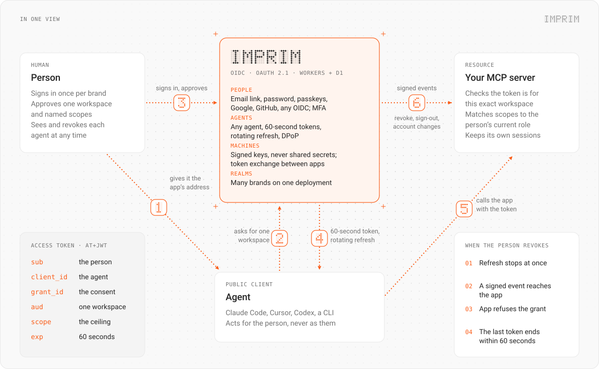

# Imprim documentation

Identity for people and the agents that act for them: OpenID Connect and OAuth 2.1 on Cloudflare Workers.

**Start here: [Getting started](GETTING_STARTED.md)**, including prompts you can hand to a coding agent.

<picture>
  <source media="(prefers-color-scheme: dark)" srcset="assets/diagrams/overview-dark.svg">
  
</picture>

| Guide | For |
|---|---|
| [Deploying](DEPLOY.md) | Running Imprim on Cloudflare, staging releases and upgrades |
| [Realms](REALMS.md) | Several brands on one deployment: hosts, keys, users, providers, admins |
| [Branding](BRANDING.md) | A Fire look, name, copy, links, logos and languages per realm and per app, and the HTML email |
| [Fire](fire/README.md) | The design system every page is built with, and how Imprim uses it |
| [Languages](TRANSLATING.md) | How a page's and an email's language is chosen, and how to add or fix a translation |
| [Integrating](INTEGRATE.md) | Adding sign-in to an app, accepting agents on an MCP server, building an agent |
| [MCP probe example](https://github.com/Vibernt/imprim/tree/main/examples/mcp-probe) | A complete MCP server that accepts agents through Imprim, with a scripted agent that tests it |
| [Clients](CLIENTS.md) | Client registration settings and the `imprim-client` package |
| [Agent access](AGENT_ACCESS.md) | How agents connect for a person, and how apps protect resources |
| [Protocol](PROTOCOL.md) | Exact routes, parameters, claims and errors |
| [Configuration](CONFIGURATION.md) | Worker bindings, secrets and settings |
| [Control plane](CONTROL_PLANE.md) | The admin console and back-channel delivery |
| [Operations](OPERATIONS.md) | Keys, retention, delivery, monitoring, backups, provider apps, release gates and incidents |
| [Architecture](ARCHITECTURE.md) | Components, schema and request flows |
| [Security](SECURITY.md) | Threat model, controls, and what is not yet verified live |
| [Security pass 2026-11-15](SECURITY_PASS.md) | The latest review and its fixes |
| [Roadmap](ROADMAP.md) | What is planned next |
